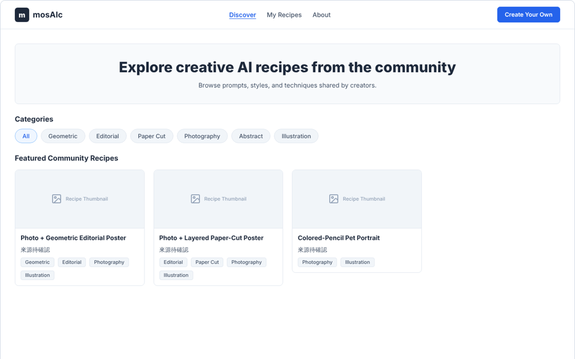
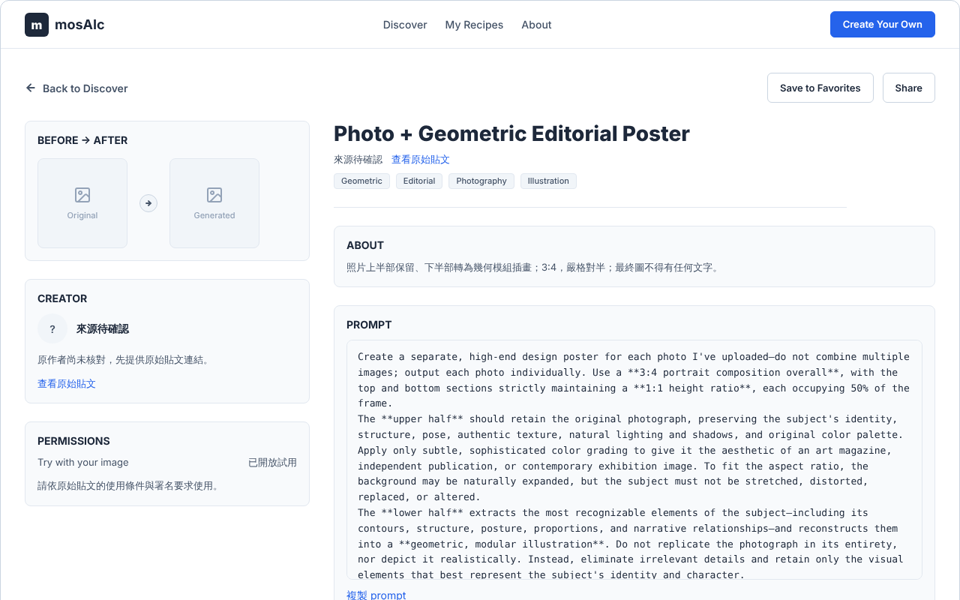
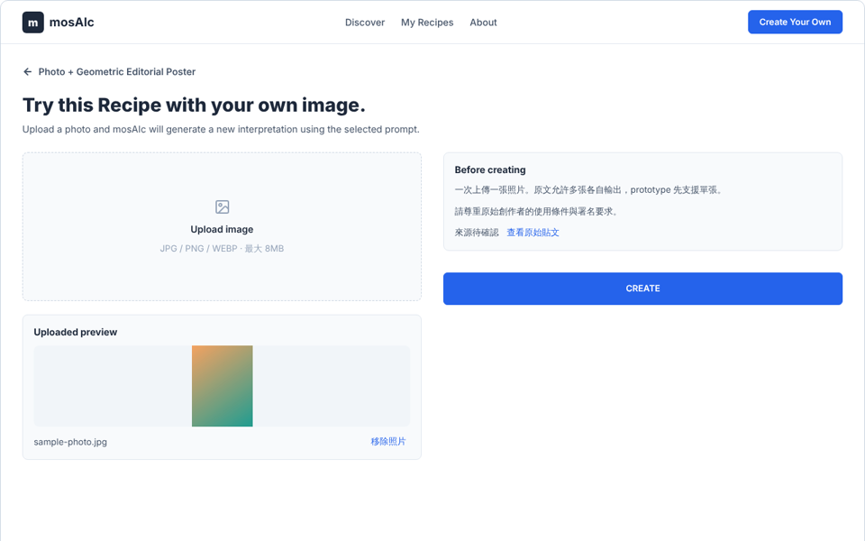
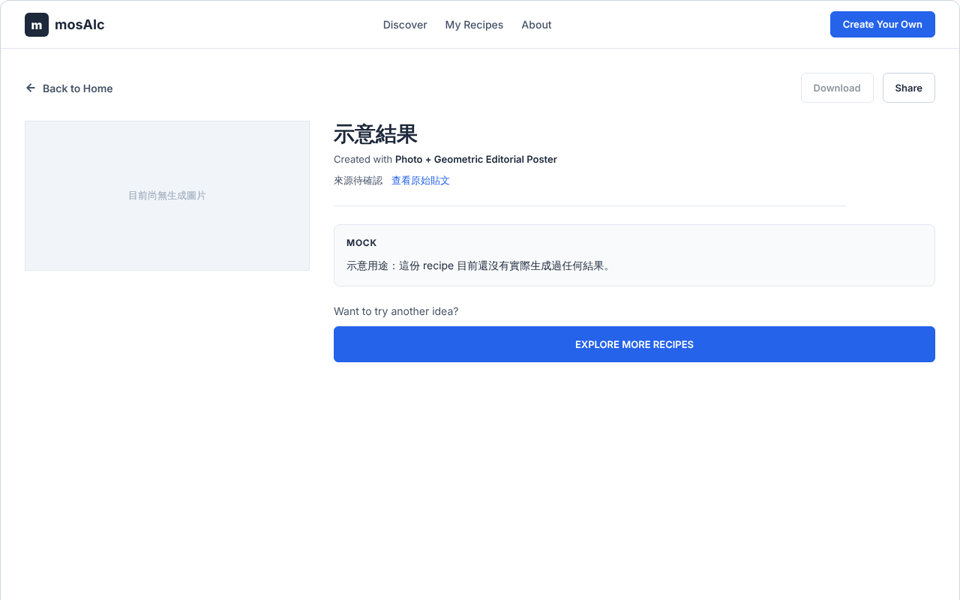

# mosAIc

**Try the AI image prompts creators share, on your own photo, without losing track of who made them.**

[中文說明](README.zh-TW.md)

Creators on social media spend hours testing and refining image-generation prompts before they share them. mosAIc collects those prompts as "recipes" in one gallery. Pick a recipe, read the full prompt and the original post, upload a photo, and mosAIc runs the prompt for you. No copying text, no switching between AI tools. Every recipe and every result keeps a link back to the creator.


<sub>Walkthrough recorded locally with one recipe temporarily opened for Try and no AI key configured, so the result page honestly shows a placeholder ("示意結果").</sub>

## Demo video

> 🎬 **Full demo video with live AI generation: coming soon.**
>
> <!-- Replace this block with the video link (YouTube / Vimeo) or drag an .mp4 into a GitHub edit of this file. -->

## How it works

| 1. Discover                                                        | 2. Read the recipe                                                                           |
| ------------------------------------------------------------------ | -------------------------------------------------------------------------------------------- |
|                         |                                                       |
| Browse recipes and filter by style. Save favorites on your device. | See the full prompt, what to upload, and links to the original post and the creator.         |
| **3. Try it**                                                      | **4. Get your result**                                                                       |
|                             |                                                       |
| Upload one JPEG / PNG / WebP photo (up to 8 MB) and press Create.  | Download or share the image. The page always says how it was made and who shared the prompt. |

## Features

- **Creator first.** Every recipe links to its original post, and to the creator's Instagram once verified. Unverified creators show `來源待確認` instead of a guess.
- **One-click try.** The server pairs your photo with the recipe's stored prompt and sends both to the image model. The browser never handles API keys or sends prompt text.
- **Honest results.** Each result is labelled `live` (made from your photo just now), `cached` (a prepared example from a test photo) or `mock` (placeholder). A sample is never passed off as yours.
- **Your photo isn't kept.** mosAIc forwards it to the image model and does not save it.
- **Private, shareable results.** Every result has its own unguessable link that still works after a refresh. Nothing is listed publicly; it is seen only if you share it. Links expire after 30 days.
- **Fair use built in.** Per-visitor and daily limits, a daily spending ceiling and duplicate-click protection keep a free demo from running up a bill. The site's `/privacy` page explains how data is handled.

## Recipes

| Recipe                             | Effect                                                                                         | Upload        |
| ---------------------------------- | ---------------------------------------------------------------------------------------------- | ------------- |
| Photo + Geometric Editorial Poster | Top half keeps your photo, bottom half becomes a geometric illustration. 3:4, no text.         | One photo     |
| Photo + Layered Paper-Cut Poster   | Top half keeps your photo, bottom half becomes layered paper-cut art with editorial type. 3:4. | One photo     |
| Colored-Pencil Pet Portrait        | A small, vivid colored-pencil head portrait on white. 4:5.                                     | One dog photo |

The first recipes come from public Threads posts. They open for Try once each creator and the basis for running their prompt have been confirmed.

## Run it locally

Requirements: Node.js 24+, pnpm 11, Python 3.10+. Run everything from the repository root.

```sh
pnpm install
python3 -m venv apps/backend/.venv
apps/backend/.venv/bin/pip install -r apps/backend/requirements.txt   # Windows: apps\backend\.venv\Scripts\pip
cp apps/backend/.env.example apps/backend/.env                          # then add GEMINI_API_KEY
bash scripts/dev.sh
```

Open http://localhost:3000. `scripts/dev.sh` starts the API on port 8000 and the website on port 3000 (use `BACKEND_PORT=8010 bash scripts/dev.sh` if 8000 is busy). On Windows, start the two parts separately:

```sh
apps/backend/.venv/Scripts/python -m uvicorn app.main:app --app-dir apps/backend --port 8000 --no-proxy-headers
pnpm dev
```

Or run both in Docker: `docker compose up --build` (website on 3000, API on 8010).

### AI generation

Live generation uses a Google Gemini image model. Put a key from [Google AI Studio](https://aistudio.google.com/apikey) in `apps/backend/.env` as `GEMINI_API_KEY`. Without a key the app still runs and every result is a clearly labelled `cached` or `mock` result.

To open a recipe for Try, set its `tryReady` to `true` in `apps/backend/data/recipes.json`. To prepare a `cached` fallback for demos, run:

```sh
cd apps/backend && .venv/bin/python -m scripts.pregen seed-01 path/to/test-photo.jpg
```

## Tests

```sh
bash scripts/test-all.sh   # everything below, in order; stops at the first failure
```

| What                                                       | Command                                                             |
| ---------------------------------------------------------- | ------------------------------------------------------------------- |
| Format + TypeScript                                        | `pnpm lint`                                                         |
| Backend unit tests                                         | `cd apps/backend && .venv/bin/python -m unittest discover -s tests` |
| API status codes over HTTP                                 | `bash apps/backend/tests/test_api.sh`                               |
| Web client, real upload, proxy                             | `pnpm test`                                                         |
| Production build                                           | `pnpm build`                                                        |
| Browser tests (journey, accessibility, links, performance) | `pnpm test:e2e`                                                     |

Browser tests use Playwright with a fake image model, so they never call Google or cost money. Install dev tools with `apps/backend/.venv/bin/pip install -r apps/backend/requirements-dev.txt`. CI runs the same script plus `pnpm audit` and `pip-audit` on every push.

To check a deployed site (read-only), run `bash scripts/smoke.sh https://your-site`. Add `SMOKE_GENERATE=1` to also run one real, billable generation.

## Project structure

```
apps/web         Next.js website (App Router, React, TypeScript)
apps/backend     FastAPI API, recipe data, generation pipeline, tests
apps/mobile      Reserved for a future Expo app
packages/api     Typed API client shared by web and mobile
packages/types   Shared API types
packages/core    Upload validation
packages/design  Design tokens
docs/            Product, API contract, design notes and release reports
```

More detail: [product](docs/product/README.md) · [API contract](docs/architecture/api-contract.md) · [design](docs/design/README.md)

## Deploying

The website needs a running Next.js server (not a static export): it proxies `/api/*` and `/static/*` to the FastAPI server set in `BACKEND_URL` at build time. Allow requests of at least 75 seconds, since generation can take up to 60.

Settings (all server-side; see `apps/backend/.env.example` and `apps/web/.env.example`):

| Where   | Variable                                                      | Purpose                                                                   |
| ------- | ------------------------------------------------------------- | ------------------------------------------------------------------------- |
| API     | `GEMINI_API_KEY`                                              | Turns on live generation. Set a spending cap in Google AI Studio too.     |
| API     | `MOSAIC_DAILY_GLOBAL` (default 50)                            | Paid generations per day across all visitors                              |
| API     | `MOSAIC_RATE_PER_MINUTE` / `MOSAIC_DAILY_PER_CLIENT` (3 / 10) | Per-visitor limits                                                        |
| API     | `BLOB_READ_WRITE_TOKEN`                                       | Vercel Blob for results. On Vercel, live generation stays off without it. |
| Both    | `MOSAIC_PROXY_SECRET`                                         | Same random value on both, so limits count real visitors                  |
| Website | `BACKEND_URL`                                                 | The API's origin                                                          |

Limits are conservative defaults, not final product decisions. Details: [API contract](docs/architecture/api-contract.md) · [release checklist](docs/release/v0.1-release-checklist.md) · [security and cost review](docs/release/v0.1-security-cost-review.md).

## Roadmap

- [x] Gallery, recipe, try and result pages connected to the API
- [x] Honest live / cached / mock results
- [x] Gemini image generation
- [x] Cost limits, result storage, privacy and terms, accessibility checks, CI
- [ ] Verify creators and Instagram links; add their preview images
- [ ] Open the first recipes for Try and record the demo video
- [ ] Deploy a public instance
- [ ] Expo mobile app on the shared packages

## Team

Built by [@joojoohappy](https://github.com/joojoohappy) and [@ZoeWTY](https://github.com/ZoeWTY).
