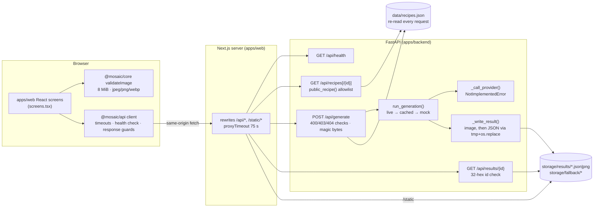

# 01 — Architecture Audit

Audited revision: `c76a78a` (main, 2026-09-28) of `joojoohappy/mosAIc`.
Audit date: 2026-10-23. Method: read every tracked source file, then ran every test that exists (see [execution-log.md](execution-log.md)).

## 1. What MOSAIC is, in one paragraph

MOSAIC ("mosAIc") is a web app that collects image-generation prompts ("recipes") that creators shared on Threads, shows each recipe with its original source link, and lets a visitor upload one photo to run that recipe. Its distinguishing design goal is **honest provenance**: a result must say whether it was generated from *your* photo (`live`), is a pre-generated sample (`cached`), or is only a placeholder (`mock`), and the server — not the UI — writes that disclosure.

**The AI part does not exist yet.** `_call_provider()` in [`apps/backend/app/generation.py`](../../apps/backend/app/generation.py) raises `NotImplementedError`, all three recipes ship with `tryReady: false`, and no fallback assets exist. Every real request today ends in `403 recipe_not_ready` or, if a recipe is flipped on, a `mock` result with no image. This is stated plainly in the repo's own README and ROADMAP; the audit confirms it.

## 2. Repository map (what is actually there)

| Path | Lines (HEAD) | What it is | Status |
|---|---|---|---|
| `apps/backend/app/main.py` | 97 | FastAPI HTTP layer: 5 routes + `/static` mount | **Verified** (tests + benchmarks) |
| `apps/backend/app/generation.py` | 202 | Framework-free pipeline: mode decision, fallback sidecar validation, atomic result write, result lookup | **Verified** except provider |
| `apps/backend/app/recipes.py` | 34 | Recipe lookup + allowlist public projection (prompt never leaves the server) | **Verified** |
| `apps/backend/data/recipes.json` | 38 | 3 seed recipes incl. full prompt text | Data |
| `apps/backend/scripts/pregen.py` | 59 | CLI to pre-generate a `cached` fallback with provenance sidecar | **Unverifiable** (needs provider) |
| `apps/backend/tests/test_generation.py` | 283 | 36 stdlib-unittest tests | **Verified** — 36/36 pass |
| `apps/backend/tests/test_api.sh` | 75 | 17-check HTTP contract smoke test | **Verified** — 17/17 pass |
| `packages/api/src/client.ts` | 187 | Typed API client: timeouts, health-based error diagnosis, response validation | **Verified** — 9 unit + 5 real-HTTP tests |
| `packages/types/src/*.ts` | ~75 | Shared wire contract (`PublicRecipe`, `GenerationResult`, `ApiError`) | Types only |
| `packages/core/src/index.ts` | 11 | Upload validation (8 MiB, JPEG/PNG/WebP) | **Verified** |
| `packages/design/tokens.css` | — | Design tokens | Not evaluated |
| `apps/web/` (Next.js 16, React 19) | ~875 TSX | 7 routes, 3 component files, same-origin rewrites to FastAPI | **Implemented, not verified here** (see §6) |
| `apps/mobile/` | 0 code | `.gitkeep` placeholders for a future Expo app | **Planned** |
| `content/recipes/` | README only | Reserved | **Planned** |
| `docker-compose.yml`, two `Dockerfile`s | — | "Verification-only" images; web runs `next dev` | **Implemented, not verified** (no Docker daemon in audit environment) |
| CI | — | none | **Missing** (one added by this study — unexecuted) |

## 3. Architecture as implemented

Request path for the core journey (Discover → Recipe → Create → Result):

1. `GET /api/recipes` → `public_recipe()` projects an **allowlist** of 9 fields; `prompt` can never be serialized ([`recipes.py` `PUBLIC_FIELDS`, `public_recipe()`](../../apps/backend/app/recipes.py)).
2. Create page disables upload unless `tryReady` is true ([`screens.tsx` Create, `available`](../../apps/web/components/screens.tsx)).
3. `POST /api/generate` (multipart `recipeId` + `image`) → checks in order: missing id (400) → unknown recipe (404) → not ready (403) → missing image (400) → >8 MiB (400) → magic bytes (400) → `run_generation()` ([`main.py` `generate()`](../../apps/backend/app/main.py)).
4. `run_generation()` tries the provider only if an API key exists, validates provider output with the same magic-byte check as uploads, otherwise falls back to a provenance-checked `cached` asset, otherwise `mock`. The result is written once, image first, JSON atomically ([`generation.py` `run_generation()`, `_write_result()`](../../apps/backend/app/generation.py)).
5. Browser navigates to `/result/{resultId}` and fetches the persisted result; refresh works because results live on disk.

## 4. Engineering decisions already made (with code evidence)

| Decision | Evidence | Assessment |
|---|---|---|
| Prompt stays server-side; client sends only `recipeId` | `public_recipe()` allowlist; `generate()` loads prompt itself; test `test_provider_is_given_the_stored_prompt_not_the_caller_input` | Sound. Prevents the API key becoming a free generator. |
| Allowlist (not denylist) projection | `PUBLIC_FIELDS`; test `test_projection_is_an_allowlist_not_a_denylist` | Sound, and tested. |
| Server-authored provenance (`mode` + `sourceNote`), rendered verbatim | `_source_note()`; types comment "Render VERBATIM"; `isGenerationResult()` rejects `mock` with an image | The most distinctive decision in the repo; enforced on both sides. |
| Magic-byte sniffing for uploads **and** provider output | `_is_image()` used in `generate()`, `run_generation()`, `_read_sidecar()` | Sound; one definition for two trust boundaries. |
| Atomic result write (`tmp` + `os.replace`) after mode is decided | `_write_result()`; tests `test_no_temp_file_left_behind`, `test_only_write_result_touches_disk` | Sound for a single host. |
| Sync `def` routes so a blocking provider SDK runs in the threadpool | `main.py` docstring | Correct for one request; **breaks at 40 concurrent generations** (measured, §5). |
| `tryReady` gate before generation | `generate()` 403; startup warning | Sound product gate. **Claim "no reason to pull 8MB off the wire" is not what happens** (measured, §5). |
| Same-origin proxy via Next.js rewrites (no CORS) | `next.config.ts` | Simple; couples deployment to a Next.js server (documented). |
| No automatic retry of generation (non-idempotent, costs money) | `client.ts` `generate()`; test `timeouts check health and never retry generation` | Correct. |
| Health-check-based error diagnosis in the client | `client.ts` `request()` | Thoughtful UX: distinguishes "backend down" from "request failed". |
| Results stored as files, addressed by 128-bit random id | `uuid.uuid4().hex`, `RESULT_ID_RE` | Fine for a prototype (capability URLs). No retention policy. |
| Cached mode **copies** the fallback image per request | `_write_result()` writes `img` bytes for every result | Keeps each result immutable even if the fallback is replaced; costs disk (measured: 1.5 MB per request with a 1.5 MB asset). |

## 5. What the audit found (each item verified by a test or measurement)

| # | Finding | Severity | Evidence |
|---|---|---|---|
| F1 | **Shared-threadpool head-of-line blocking.** Generation and the read routes (`/api/health`, recipes, results) share Starlette's default 40-thread pool. With ≥40 slow generations in flight, `/api/health` waited ~4.8 s instead of ~3 ms, so the client's health-based diagnosis would report "後端未啟動" for a backend that is merely busy. | High once a provider exists | S2 in [04](04-benchmark-results.md) |
| F2 | **No provider deadline.** The docstring requires "a hard deadline", but nothing enforces it. A hung provider kept the request open until the caller gave up (20 s in the test; 75 s via the Next proxy) and left the worker thread busy. | High once a provider exists | S4 |
| F3 | **Upload size is checked after the whole body is received.** Starlette parses and spools the entire multipart body before the route runs, so a 256 MB upload was fully transferred (268 MB) before the 400/403. The code comment "no reason to pull 8MB off the wire" describes intent, not behavior. Memory stayed bounded (spooled to disk). | Medium (bandwidth/disk abuse) | S3 |
| F4 | The `403 recipe_not_ready` path costs almost as much as a full mock generation (p50 7.4 ms vs 9.7 ms at concurrency 1), for the same reason as F3. | Low | S1 |
| F5 | `cached` mode writes a full copy of the fallback image per request; results are never cleaned up. | Medium for a public demo | S5 |
| F6 | `requirements.txt` is unpinned (`fastapi`, `uvicorn[standard]`, …). Builds are not reproducible; this audit itself ran on FastAPI 0.160.0 / Starlette 1.7.0, which may differ from what the authors used. | Medium | file |
| F7 | `test_api.sh` waits for the server with an unbounded `until curl` loop. When `uvicorn` was missing it hung forever (observed in this audit). `dev.sh` already had the bounded fix. | Low | execution log |
| F8 | `test_api.sh` mutates the real `data/recipes.json` and writes results into the real `storage/`, relying on an `EXIT` trap to restore. A `kill -9` leaves `tryReady: true` on disk. (The newer wire test does it right: temp copy.) | Low | file |
| F9 | `.env.example` names `ANTHROPIC_API_KEY` for an **image** provider. The Anthropic API returns text, not images, so this variable name presumes a provider that cannot fulfil `_call_provider`'s contract. Needs a decision, not a code fix. | Info | file |
| F10 | The web client uploads the original file (up to 8 MiB) with no client-side downscale. Once a provider exists, upload time on mobile uplinks and provider input limits will dominate latency. | Info (future) | `screens.tsx` `submit()` |
| F11 | No CI; no structured logging, metrics or request ids (only `print`). | Medium | repo |

## 6. Classification of components

| Component | Classification | Why |
|---|---|---|
| Backend HTTP contract (5 routes, 7 error codes) | **Verified** | 17/17 smoke checks + 5 real-HTTP wire tests re-run here |
| Generation mode logic, sidecar validation, atomic writes | **Verified** | 36/36 unit tests re-run here |
| API client error mapping, timeouts, response guards | **Verified** | 9/9 tests re-run here |
| AI provider integration | **Missing** | `NotImplementedError` |
| Pre-generation (`pregen.py`) / cached fallback assets | **Partial** — code exists, cannot run | depends on provider |
| Web frontend (Next.js) | **Implemented but unverified in this audit** | Next.js could not be installed (package registry blocked in the audit sandbox). The repo's [`docs/architecture/validation.md`](../architecture/validation.md) reports a passing build/typecheck on Windows ARM64 on 2026-09-28; that claim is **reported, not re-verified**. |
| Docker / compose | **Implemented but unverified** | No Docker daemon in the audit sandbox; web image is explicitly `next dev`, not production |
| Deployment, observability, CI | **Missing** | — |
| Mobile app, editorial content, accounts, remix lineage | **Planned / described only** | READMEs and About page copy |

## 7. Where the real technical complexity is

1. **Truthful-result pipeline** (`generation.py`): three modes, provenance sidecars checked for completeness and consistency (all fields present, image path inside `fallback/`, image header is a real JPEG/PNG/WebP signature), a failure model where any provider error degrades instead of raising, and write-ordering that makes an abandoned provider thread harmless. Small (200 lines) but dense with deliberate invariants, each pinned by a test.
2. **Trust boundaries**: prompt confidentiality via allowlist, magic-byte (file-header) checks at two boundaries, path-traversal-safe result ids, `sourceNote` verbatim rendering enforced by a client-side type guard.
3. **Client resilience** (`client.ts`): per-request timeouts, health probe to classify failures, no retry for a non-idempotent call, runtime validation of every payload.

Everything else (gallery, detail pages, favorites in `localStorage`) is ordinary product UI.

## 8. A note on the earlier local copy

The user's machine also holds `~/ai-creative-playground-main/mosaic`, a Build Day (2026-09-20) Next.js-only prototype in which "generation" is a canvas composition drawn in the browser, plus `~/mosAIc`, an empty folder skeleton. Neither is the subject of this study; the GitHub repo supersedes both. Browser tests written against the prototype during the first hour of this study are kept outside the repo and not reported as MOSAIC results.
