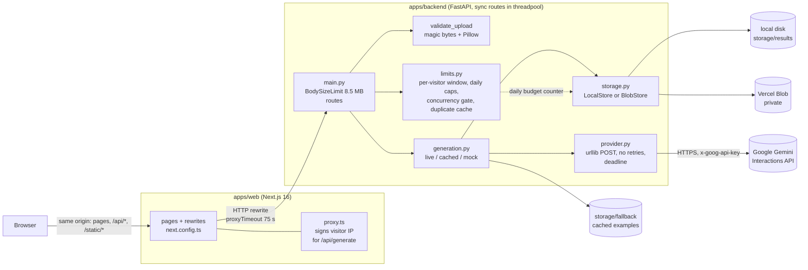

# 01 · Architecture audit

Audited: 2026-10-22, branch `claude/project-cleanup-readme` at `fbbc625` (PR #2, the v0.1 release candidate, not yet merged), compared with `main` at `c76a78a`. Every statement below points at source, a test, or a measurement in [`benchmarks/results/`](../../benchmarks/results/). Where something could not be checked from this environment, it says so.

## 1. What MOSAIC is, in one paragraph

A web gallery of "recipes": public image-generation prompts that creators shared on social media. A visitor picks a recipe, uploads a photo, and the backend sends **the stored prompt plus the photo** to an external image model (Google Gemini, via HTTPS). The result page always says how the image was made: `live` (generated from your photo), `cached` (a pre-generated example, with provenance), or `mock` (nothing generated yet). There is no model hosting, no training, no GPU, no queue and no database. The engineering weight sits in **calling a paid, slow, external model safely**: who may trigger a paid call, how many, what happens when it fails or stalls, and never presenting a fallback as the user's own result.

## 2. Repository layout

| Path                               | What it is                                                                                                                                                                     | Size (lines) |
| ---------------------------------- | ------------------------------------------------------------------------------------------------------------------------------------------------------------------------------ | ------------ |
| `apps/backend/app/`                | FastAPI service: `main.py` (HTTP), `generation.py` (pipeline), `provider.py` (Gemini client), `limits.py` (cost/abuse), `storage.py` (local disk or Vercel Blob), `recipes.py` | 1,048        |
| `apps/backend/tests/`              | `unittest` suites + `test_api.sh` (real HTTP)                                                                                                                                  | 997          |
| `apps/web/`                        | Next.js 16 (App Router) + React 19 website, `proxy.ts` (request middleware)                                                                                                    | 2,410        |
| `packages/{api,types,core,design}` | Typed API client with runtime response validation, shared types, upload rules, CSS tokens                                                                                      | 358          |
| `tests/`                           | Node tests for the client/upload/proxy, Playwright E2E + axe/link/perf checks                                                                                                  | 1,318        |
| `scripts/`                         | `test-all.sh` (every check), `smoke.sh` (post-deploy), `dev.sh`                                                                                                                | 159          |
| `.github/workflows/`               | CI (`ci.yml`), post-deploy smoke (`smoke.yml`)                                                                                                                                 | 74           |
| `apps/mobile/`                     | README only. No code.                                                                                                                                                          | 0            |

## 3. Architecture as implemented

Request path for one generation (`POST /api/generate`, [`main.py`](../../apps/backend/app/main.py)):

1. `BodySizeLimit` ASGI middleware refuses bodies over 8.5 MB, by `Content-Length` and by counting streamed bytes.
2. `recipeId` → server-side recipe lookup. The client never sends prompt text, so the API key cannot be used as a free general-purpose image generator.
3. `tryReady` gate: unverified recipes return 403 before anything is read.
4. Read at most 8 MB + 1 byte, then `validate_upload` (magic bytes, pixel cap, decode).
5. SHA-256 fingerprint of recipe + photo; a finished identical request within 10 min returns the same `resultId`.
6. Per-visitor limits (3/min, 10/day by default). Visitor identity never comes from `X-Forwarded-For`; on Vercel, `proxy.ts` signs the platform IP with a shared secret.
7. Concurrency gate (2 model calls at once per process); over it → immediate 503 `server_busy` (load shedding, no queue).
8. Global daily budget reserved **before** the paid call (`DailyBudget.reserve`).
9. Provider call with a 60 s deadline and no retries. Any failure → fallback result with a public reason code; details only in the log.
10. Result image then result JSON written to the store (image first, so a reader never sees a URL to a missing file). Response: `{resultId}`.

The browser then `GET`s `/api/results/{id}` and `/static/results/{name}`. The generation itself is **synchronous** inside the HTTP request (client timeout 75 s, Next rewrite timeout 75 s, provider deadline 60 s), not a background job.

## 4. Component status

Legend: **Verified** = exercised by a test or benchmark that ran in this audit. **Implemented, unverified** = code exists but the real dependency was never exercised. **Partial** = works with a measured gap. **Planned** = described only. **Missing** = not present.

| Component                                                  | Status                                                    | Evidence                                                                                                                                                                                                                                                     |
| ---------------------------------------------------------- | --------------------------------------------------------- | ------------------------------------------------------------------------------------------------------------------------------------------------------------------------------------------------------------------------------------------------------------ |
| Recipe API + public projection (allowlist, hidden prompts) | Verified                                                  | [`recipes.py`](../../apps/backend/app/recipes.py), `tests/test_generation.py` RecipeLookup; B1 latency                                                                                                                                                       |
| Upload validation                                          | **Partial → fixed in this branch**                        | PR #2: JPEG truncated to 1 % passed validation and reached the provider ([`reliability_baseline.json`](../../benchmarks/results/reliability_baseline.json) `corrupt_uploads`). Fixed: [05 §1](05-engineering-improvements.md)                                |
| Live/cached/mock disclosure invariants                     | Verified                                                  | `tests/test_generation.py` Disclosure; E2E "model errors and timeouts end in an honest fallback"                                                                                                                                                             |
| Gemini integration                                         | Implemented, **unverified against the real API**          | [`provider.py`](../../apps/backend/app/provider.py) written from Google's docs; only a local fake server has answered it (PR #2 and this audit). No API key was available.                                                                                   |
| Provider timeout                                           | **Partial → fixed**                                       | Per-read socket timeout only: a 2 s timeout took 12.6 s against a slow-drip upstream. Fixed: [05 §2](05-engineering-improvements.md)                                                                                                                         |
| Per-visitor rate limit, spoof resistance                   | Verified                                                  | `tests/test_limits.py`; B3 `rate_limits`: 6 forged `X-Forwarded-For` values → `[200,200,200,429,429,429]`                                                                                                                                                    |
| Duplicate protection                                       | **Partial → fixed**                                       | Finished duplicates: verified. Overlapping duplicates (refresh/second click during the model call) paid twice. Fixed: [05 §3](05-engineering-improvements.md)                                                                                                |
| Global daily budget                                        | Verified single-process; **approximate across processes** | Exact with 1 worker (5/5 trials = 50 calls for limit 50). With 4 workers, lost updates (no cross-process lock) → overshoot, plus HTTP 500s from a temp-file collision. 500s fixed ([05 §4](05-engineering-improvements.md)); overshoot documented, not fixed |
| Concurrency gate / load shedding                           | Verified                                                  | B2 `shedding`: 10 simultaneous → 2 served, 8 × 503 in < 60 ms                                                                                                                                                                                                |
| Body size limit                                            | Verified (minor gap)                                      | Declared 9 MB → 413. Chunked 9 MB without length → refused, but as FastAPI's generic 400, not 413 (browsers always send a length)                                                                                                                            |
| LocalStore (disk)                                          | Verified                                                  | Results survive SIGTERM and SIGKILL restarts (B3 `restart_recovery`)                                                                                                                                                                                         |
| BlobStore (Vercel Blob)                                    | Implemented, unverified against real Blob                 | `tests/test_storage.py` uses a fake Blob client. No Blob store is connected yet.                                                                                                                                                                             |
| Result retention (30 days)                                 | Partial                                                   | Expired results stop being served; nothing deletes them                                                                                                                                                                                                      |
| Website (8 routes), typed client with response validation  | Verified                                                  | Playwright journey (10 tests), axe on 12 routes × 2 widths, `tests/api.test.mjs`                                                                                                                                                                             |
| Browser-side resize for 4–8 MB photos                      | Verified                                                  | E2E "a 4–8MB photo is shrunk in the browser"                                                                                                                                                                                                                 |
| Docker images + compose                                    | Verified (backend)                                        | B4: backend image builds; container answers `/api/health` ~1.0 s after `docker run`; web image is `next dev` (verification only, not production)                                                                                                             |
| Vercel deployment                                          | Implemented, unverified                                   | Two Vercel projects; previews build, but sit behind Deployment Protection so no smoke test has passed. Production still serves `main` (`c76a78a`). Not reachable from this sandbox.                                                                          |
| CI                                                         | Verified                                                  | GitHub Actions `test` job green on `fbbc625`; this audit re-ran `scripts/test-all.sh` locally: 7/7 stages                                                                                                                                                    |
| Observability                                              | Partial                                                   | Plain-text `logging` lines per generation (`mode`, `reason`, seconds); no request IDs, metrics, tracing, or alerting                                                                                                                                         |
| Mobile app                                                 | Planned                                                   | `apps/mobile/README.md` only                                                                                                                                                                                                                                 |
| Container healthcheck                                      | Missing                                                   | Neither Dockerfile nor compose declares one (B4)                                                                                                                                                                                                             |
| Auth / user accounts                                       | Missing by design                                         | Anonymous product; favorites live in `localStorage`                                                                                                                                                                                                          |

## 5. What is on `main` versus PR #2

`main` (`c76a78a`, what production serves) has the four pages and the recipe API, but `_call_provider` raised `NotImplementedError` and read `ANTHROPIC_API_KEY`; results were written to local disk (lost on Vercel); there were no limits, no CI and no E2E tests. Everything about real generation, cost control, Blob storage, the proxy signature, CI and the browser tests exists **only on the PR #2 branch**. This audit and its fixes are on `claude/engineering-case-study`, branched from PR #2.

## 6. Engineering decisions already made (with where they live)

| Decision                                                                  | Where                                        | Note                                                                |
| ------------------------------------------------------------------------- | -------------------------------------------- | ------------------------------------------------------------------- |
| Synchronous generation inside the request, no queue                       | `main.py`, client `75_000` timeout           | Fits ≤ 50 paid calls/day; see [ADR-1](07-architecture-decisions.md) |
| Sync `def` routes so the event loop is never blocked by the model call    | `main.py` docstring                          | `/api/health` stays responsive during generation                    |
| Load shedding (503) instead of queueing beyond 2 concurrent calls         | `limits.py` `acquire`                        | Bounds spend and memory; pushes retry to the user                   |
| No provider retries                                                       | `provider.py`                                | Each retry is a paid call; failure → honest fallback                |
| Budget reserved before the call, counted on failure too                   | `generation.py` `run_generation`             | Timeouts may still be billed upstream                               |
| Never trust `X-Forwarded-For`; HMAC-style shared secret from the web tier | `limits.py` `client_id`, `apps/web/proxy.ts` | Fixed a spoofing bypass found in PR #2 review                       |
| Same-origin API through Next rewrites, no CORS                            | `next.config.ts`, `main.py` docstring        | Other sites cannot call the API from a visitor's browser            |
| Allowlist projection of recipe fields                                     | `recipes.py` `PUBLIC_FIELDS`                 | New fields stay private by default                                  |
| Private Blob storage, images served through the API                       | `storage.py`                                 | Share links work regardless of Blob ACL                             |
| stdlib `urllib` instead of the Google SDK                                 | `provider.py`                                | One POST; fewer dependencies                                        |
| Live generation off on Vercel without shared storage                      | `generation.live_blocker`                    | Avoids paying for results that would vanish                         |

## 7. Where the technical complexity actually is

Not in model work. MOSAIC does no inference, fine-tuning, model conversion or serving; any claim of "inference optimization" or "GPU" would be false. The non-trivial parts are:

1. **Failure semantics of a paid external model**: deadline, no retries, fallbacks that are labelled, provider output treated as untrusted (magic-byte check on returned bytes).
2. **Cost control under concurrency**: four independent limits, a shared counter in object storage, duplicate suppression.
3. **Trust boundaries**: visitor identity across two tiers, server-side prompts, upload validation, body caps before parsing.
4. **Serverless constraints**: 4.5 MB body limit (browser-side resize), no persistent disk (Blob), function timeouts aligned at 60/75/75 s.

## 8. Audit observations that were not obvious from the docs

- The PR #2 gap audit marks upload security and cost controls as **PASS**. Measured, both had holes (truncated JPEGs, overlapping duplicates). The existing unit test for truncation cut the file to 40 bytes, which fails at header parsing and therefore never exercised the decode step.
- `generation.py`'s docstring describes "a zombie thread that finishes after the timeout", but `provider.py` had no thread or overall deadline. The invariant was documented for a design that was no longer there.
- `limits.py` stated the budget overshoot was bounded by `MAX_CONCURRENT` per instance. Lost updates make it unbounded in principle; measured in [04](04-benchmark-results.md).
- The E2E "refresh does not pay twice" test waits 3.5 s for a 3 s fake model before retrying, so it never overlapped the two requests, which is the case that failed.
