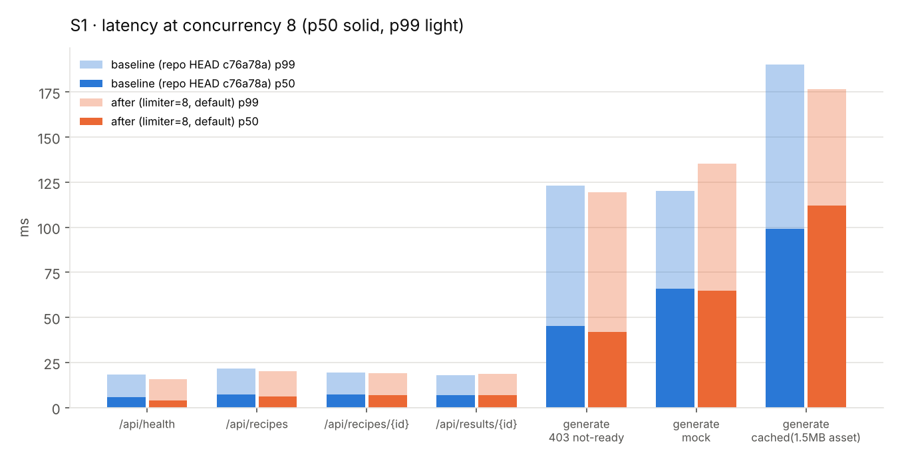

# 04 — Benchmark Results

Every number below is copied from [`benchmarks/results/summary.md`](../../benchmarks/results/summary.md), which [`benchmarks/report.py`](../../benchmarks/report.py) generates from [`baseline.json`](../../benchmarks/results/baseline.json), [`after.json`](../../benchmarks/results/after.json) and [`after-limit40.json`](../../benchmarks/results/after-limit40.json). Per-request samples for S1 and S5 are in [`benchmarks/raw/`](../../benchmarks/raw/).

- **baseline** = `apps/backend` at `c76a78a` (exported with `git archive`).
- **after** = final tree of this study (ADR-7/8/9; generation limiter = 8).
- **after (limit 40)** = same code with `MOSAIC_MAX_CONCURRENT_GENERATIONS=40`.
- Environment: 2 vCPU x86_64 sandbox, loopback, load generator on the same host ([03](03-benchmark-methodology.md) §3). **No AI model is involved in any measurement.** Scenarios marked *(simulated provider)* replace only the unimplemented `_call_provider` with a sleep.

---

## S2 — Does a slow generation starve other routes? *(simulated 5 s provider)*

One `GET /api/health` probe issued while N generations are in flight. Median of 3 trials, fresh server per trial.

| upload | in flight | baseline health | after (limit 8) health | after (limit 40) health | baseline: all N done | after (8): all N done | after (40): all N done |
|---|---|---|---|---|---|---|---|
| 1×1 PNG | 0 | 1.8 ms | 1.7 ms | 1.3 ms | — | — | — |
| 1×1 PNG | 20 | 3.1 ms | 2.0 ms | 2.2 ms | 5.05 s | 15.08 s | 5.08 s |
| 1×1 PNG | 39 | 2.8 ms | 2.6 ms | 1.9 ms | 5.09 s | 25.11 s | 5.12 s |
| 1×1 PNG | **40** | **4,818.9 ms** | **2.0 ms** | **2.1 ms** | 5.09 s | 25.10 s | 5.13 s |
| 1×1 PNG | 41 | 4,836.5 ms | 2.3 ms | 2.5 ms | 10.07 s | 30.10 s | 10.08 s |
| 1×1 PNG | 60 | 4,887.7 ms | 2.0 ms | 2.1 ms | 10.13 s | 40.13 s | 10.16 s |
| 1.64 MB photo | 40 | 4,827.8 ms | 3.0 ms | 2.2 ms | 5.42 s | 25.45 s | 5.52 s |
| 1.64 MB photo | 60 | 4,916.1 ms | 7.7 ms | 10.7 ms | 10.79 s | 40.66 s | 10.76 s |

**Reading it**

- Baseline: a sharp cliff between 39 and 40 in-flight generations. 40 is AnyIO's default thread limit; the health probe queued behind the generations and waited for the first to finish (≈ the remaining 4.8 s of a 5 s call). A real provider at 20–40 s would make the probe wait that long — and the frontend uses that probe to decide whether to show "後端未啟動" (backend not running).
- After: health stays at its no-load latency at every level, for both limiter settings. The small rise at 60 × 1.64 MB (7.7–10.7 ms) is multipart parsing on the event loop, not thread starvation.
- **Cost of the default limit 8**: total time for N generations becomes ⌈N/8⌉ × 5 s (20 → 15 s, 60 → 40 s). With limit 40 the throughput equals the baseline's while keeping health isolated. The limit is therefore a policy knob (provider rate limit), not a performance fix in itself — the isolation is the fix.

## S3 — Oversized uploads

`curl -H "Expect:"` (browser-like: no `100-continue`), median of 3. "Bytes sent" = what curl actually transmitted before the server answered.

| upload | tryReady | baseline | baseline time | baseline bytes sent | after | after time | after bytes sent |
|---|---|---|---|---|---|---|---|
| 1 MB | false | 403 | 5.1 ms | 1,048,897 | 403 | 4.8 ms | 1,048,897 |
| 8 MB | true | 200 | 27.2 ms | 8,388,929 | 200 | 27.0 ms | 8,388,929 |
| 9 MB | true | 400 | 23.9 ms | 9,437,505 | 400 | 0.8 ms | 1,769,472 |
| 64 MB | false | **403** | 175.8 ms | 67,109,186 | **400** | 0.9 ms | 1,048,576 |
| 256 MB | false | 403 | 674.5 ms | 268,435,779 | 400 | 1.0 ms | 1,245,184 |
| 256 MB | true | 400 | 737.3 ms | 268,435,779 | 400 | 0.9 ms | 917,504 |

(Full 10-row table in `summary.md`.)

- Baseline: the client sent the **entire** body every time (and the server had to read all of it, because the route only runs after multipart parsing), including for recipes that were not even runnable. On loopback 256 MB costs ~0.7 s; on a 10 Mbit/s uplink the same request would occupy the connection for minutes. Server RSS stayed ≤ 65 MB because Starlette spools to disk — the cost is bandwidth, disk and a parser busy on garbage.
- After: rejection within ~1 ms; the client had sent at most ~1.8 MB when the 400 arrived. This is curl's `size_upload` — bytes **the client sent**, not an exact count of bytes the server read (the server reads less: it rejects on the declared `Content-Length` before reading the body; the rest is socket buffering). In-limit uploads (1 MB, 8 MB) are unchanged.
- Behaviour change: oversized + not-ready now returns `400 too_large` instead of `403 recipe_not_ready`.
- Client compatibility probe (not in the table): Chromium `fetch` and curl read the early 400 body for 9, 64 and 256 MB; Node's undici and Python's urllib reported a connection reset.

## S4 — Hung provider *(simulated: provider never returns)*

5 parallel generations, client gives up after 20 s.

| | baseline | after (`MOSAIC_PROVIDER_TIMEOUT_S=5` for the test; default 60) |
|---|---|---|
| Client outcome | 5 × no response, curl timeout at 20.0 s | 5 × `200` at 5.06–5.08 s |
| Result returned | none | `mode: "mock"`, `fallbackReason: "TimeoutError: provider exceeded the 5s deadline"` |
| `/api/health` afterwards | 200, 2.7 ms | 200, 2.0 ms |
| Server threads after clients finished | 6 (from 2) | 11 (from 1) — the 5 abandoned provider calls are still sleeping in the bounded provider pool |

The deadline turns an indefinite wait into a truthful fallback. It does not free the thread (Python cannot kill threads); the pool bound (2 × limit = 16) caps how many abandoned calls can accumulate.

## S1 — Endpoint latency and throughput (regression check)

Median of 3 trials. Requests per trial: 1000 (GET) / 200 (POST) after 100 / 20 warm-up. ms unless noted.

| endpoint | conc | base rps | base p50 | base p99 | after rps | after p50 | after p99 |
|---|---|---|---|---|---|---|---|
| GET /api/health | 1 | 533.2 | 1.64 | 5.77 | 791.2 | 1.11 | 5.50 |
| GET /api/health | 8 | 1208.4 | 5.85 | 18.40 | 1698.3 | 3.89 | 15.78 |
| GET /api/health | 32 | 1627.4 | 18.79 | 41.04 | 1587.8 | 17.20 | 43.06 |
| GET /api/recipes | 1 | 467.6 | 1.88 | 6.20 | 506.4 | 1.81 | 5.69 |
| GET /api/recipes/{id} | 1 | 481.5 | 1.92 | 5.56 | 486.4 | 1.89 | 6.20 |
| GET /api/results/{id} | 1 | 487.2 | 1.89 | 5.28 | 490.3 | 1.84 | 6.03 |
| GET /api/results/{id} | 32 | 1142.3 | 27.08 | 49.11 | 1038.7 | 28.96 | 62.08 |
| POST generate → 403 not ready | 1 | 123.8 | 7.44 | 19.25 | 126.5 | 7.22 | 21.55 |
| POST generate → mock | 1 | 95.7 | 9.70 | 23.83 | 86.3 | 10.69 | 23.49 |
| POST generate → mock | 8 | 116.0 | 65.89 | 120.32 | 119.6 | 64.72 | 135.35 |
| POST generate → cached (1.5 MB asset) | 1 | 64.6 | 13.68 | 29.32 | 48.0 | 19.90 | 36.00 |

(All 21 rows: `summary.md`.)

**Reading it**

- Read routes: no change beyond trial noise (the same endpoint varies by ~10–20 % between trials on this shared 2-vCPU box).
- `/api/health`: p50 1.64 → 1.11 ms and +48 % rps at concurrency 1, because it is now answered on the event loop without a thread hop.
- **Small regression**: `POST generate → mock` p50 +1.0 ms at concurrency 1 (9.70 → 10.69 ms, consistent across all 3 trials: 9.55/9.70/9.98 vs 10.14/10.73/10.69). Cause: the body is read via `await image.read()` and generation runs via an explicit `to_thread` hop. Irrelevant next to a multi-second model call, but real.
- `cached` rows are dominated by disk writes (1.5 MB per request; ~1 GB written per trial set) and drift upward within a run in both versions (baseline trials: 11.8 / 13.7 / 20.1 ms). No conclusion is drawn from them.
- The 403 path costs 7.4 ms vs 9.7 ms for a full mock generation, confirming F4: the readiness gate runs after the 1.64 MB body has been parsed.

## S5 — Disk written per generation (both versions identical)

| mode | requests | bytes written | per request | files |
|---|---|---|---|---|
| mock | 100 | 43,000 | 430 B | 100 |
| cached (1.5 MB asset) | 100 | 150,058,200 | 1,500,582 B | 200 |

No retention exists; a public demo serving the cached fallback writes ~1.5 GB per 1,000 clicks.

## S6 — Cold start (spawn → first healthy response, 10 reps)

baseline median 431.7 ms (374.0–599.4) · after median 392.8 ms (352.2–434.6). Same within noise.

## S7 — Cost of re-reading `recipes.json` per request

31.6 µs (baseline) / 31.1 µs (after) per `load_recipes()` call for a 7,860-byte file — ~2 % of the cheapest request. Caching rejected (ADR-10).

---

## Not measured (and why)

| Metric | Reason |
|---|---|
| Model latency, tokens, cost/generation, output validity, completion rate | No model in the repository |
| GPU utilisation | No local inference |
| Frontend: build time, bundle size, page latency, web vitals | Next.js could not be installed (registry blocked) |
| Container start-up, image size | No Docker daemon |
| Behaviour through the Next.js proxy (e.g. early 400 via rewrite) | Next.js unavailable |

## Traceability check

Each figure in 04, 05, 08 and 09 was compared against `summary.md` and the raw per-trial rows on 2026-10-23 (see execution log #23).
