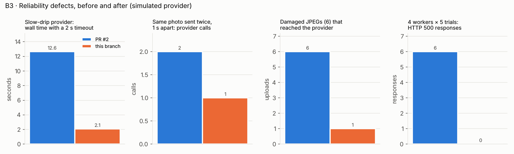
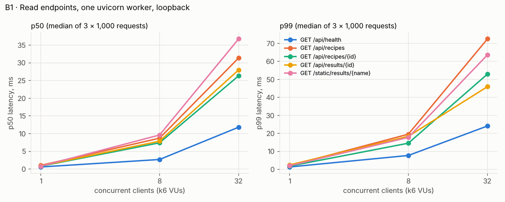
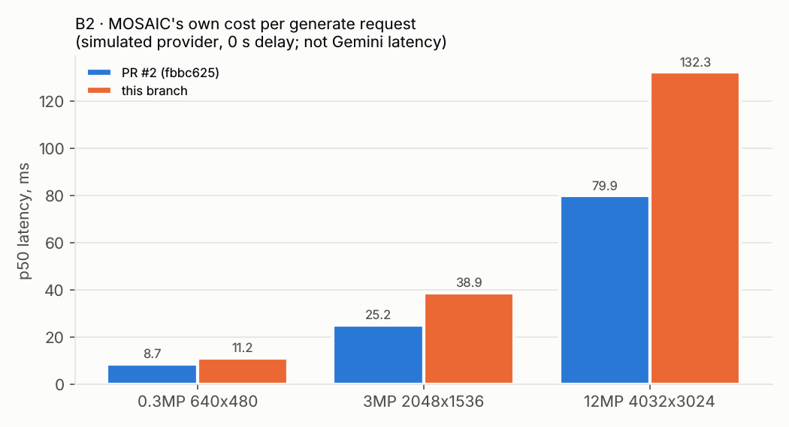
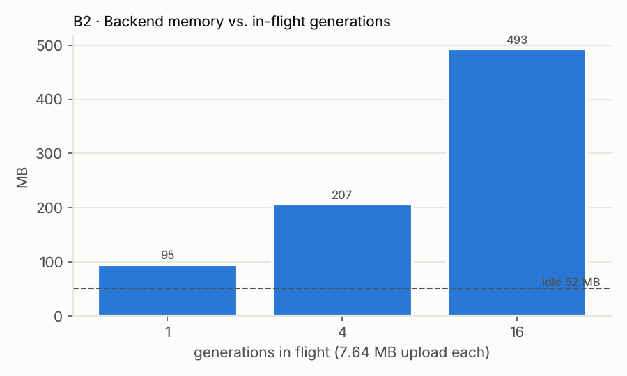

# 04 · Benchmark results

All figures come from files in [`benchmarks/results/`](../../benchmarks/results/), produced by the scripts in [`benchmarks/`](../../benchmarks/) on 2026-10-22 (methodology: [03](03-benchmark-methodology.md)). The full tables, generated from the JSON by [`report_tables.py`](../../benchmarks/report_tables.py), are in [`results/tables.md`](../../benchmarks/results/tables.md). Cells show the **median of 3 repetitions (min–max)** unless stated.

> **Simulated provider.** Every number involving `POST /api/generate` used a local fake model server. None of them is a Gemini latency, cost or quality figure. Real model performance was not measured (no API key; paid calls not approved).

"Baseline" = PR #2 head `fbbc625`. "After" = this branch with the fixes from [05](05-engineering-improvements.md).

## Headline numbers

| What                                                             | Baseline                                | After                                        | Source                                     |
| ---------------------------------------------------------------- | --------------------------------------- | -------------------------------------------- | ------------------------------------------ |
| Slow-drip provider, 2 s timeout: request wall time               | **12.63 s**, stored as `live`           | **2.07 s**, `provider_timeout`               | `reliability_*.json` → `provider_failures` |
| Same photo sent twice while the first is running: provider calls | **2** (simultaneous), **2** (1 s apart) | **1**, **1** (same `resultId`)               | `duplicates`                               |
| Damaged JPEGs (5 truncations + 1 mid-file) reaching the provider | **6 / 6**                               | **1 / 6** (mid-file corruption still passes) | `corrupt_uploads`                          |
| 4 workers, limit 50/day, 5 trials: provider calls                | 50, 50, **73**, 50, 51                  | 51, 53, 53, 53, 52                           | `budget_race`                              |
| 4 workers, 5 trials: HTTP 500 responses                          | **6**                                   | **0**                                        | `budget_race`                              |
| MOSAIC's own cost per generate, 3 MP photo (p50)                 | 25.2 ms                                 | 38.9 ms (**+13.7 ms**, regression accepted)  | `generate_*.json` → `overhead`             |
| Read endpoints p50 at concurrency 1                              | 0.66–1.02 ms                            | 0.60–1.05 ms (no change beyond noise)        | `api_latency_*.json`                       |

## B1 · Read endpoints (one uvicorn worker, k6, loopback)

After (baseline within noise; both full tables in [`tables.md`](../../benchmarks/results/tables.md)):

| Endpoint                     | Conc. | p50 ms | p95 ms | p99 ms | req/s | server CPU (cores) |
| ---------------------------- | ----- | ------ | ------ | ------ | ----- | ------------------ |
| `GET /api/health`            | 1     | 0.60   | 0.86   | 1.31   | 1,341 | 0.51               |
| `GET /api/health`            | 32    | 11.84  | 16.72  | 24.12  | 2,617 | 0.58               |
| `GET /api/recipes`           | 1     | 1.05   | 1.60   | 2.06   | 829   | 0.67               |
| `GET /api/recipes`           | 32    | 31.41  | 49.78  | 72.57  | 945   | 0.90               |
| `GET /api/results/{id}`      | 1     | 0.90   | 1.37   | 2.46   | 942   | 0.62               |
| `GET /api/results/{id}`      | 32    | 28.01  | 42.15  | 46.00  | 1,100 | 0.92               |
| `GET /static/results/{name}` | 32    | 36.78  | 53.79  | 63.71  | 848   | 1.01               |

All 90,000 measured requests (2 runs × 5 endpoints × 3 levels × 3 reps × 1,000) returned 200.

**Interpretation.**

- Throughput stops growing between concurrency 8 and 32 while latency grows ~4×: classic saturation. Little's law checks out: 32 clients / 945 req/s ≈ 34 ms ≈ measured p50 31 ms.
- The recipe and result endpoints saturate at **~0.9–1.0 core** (one Python process, GIL-bound); `/api/health` saturates at ~2,600 req/s with only ~0.6 core, so for it the limit is elsewhere (the k6 client and the event loop share 4 vCPUs).
- The per-request cost difference between `/api/recipes` (~1.06 ms CPU per request at saturation) and `/api/health` (~0.22 ms) is file reading, JSON parsing and serialisation. `load_recipes()` alone is 0.05 ms (`stages_after.json`), so most of it is FastAPI response encoding of the recipe objects; this was not profiled further (see [05](05-engineering-improvements.md), "not implemented").
- For a site whose write path is capped at 2 concurrent generations and 50 a day, ~900 req/s per worker on reads is far beyond need. These numbers are a regression baseline, not an achievement.
- **On Vercel** each result read is a Blob round trip, so `/api/results/*` latency there will be dominated by network, not by these figures.

## B2 · Generate pipeline (simulated provider)

| Photo  | Upload  | p50 baseline | p50 after | p95 after | server CPU / req after |
| ------ | ------- | ------------ | --------- | --------- | ---------------------- |
| 0.3 MP | 0.12 MB | 8.7 ms       | 11.2 ms   | 14.0 ms   | 7.8 ms                 |
| 3 MP   | 1.24 MB | 25.2 ms      | 38.9 ms   | 51.2 ms   | 34.8 ms                |
| 12 MP  | 4.81 MB | 79.9 ms      | 132.3 ms  | 166.0 ms  | 127.0 ms               |

Stage timing (in-process, after; `stages_after.json`):

| Stage                                        | 0.3 MP  | 3 MP    | 12 MP   |
| -------------------------------------------- | ------- | ------- | ------- |
| `validate_upload` (draft decode)             | 1.28 ms | 12.6 ms | 50.3 ms |
| SHA-256 fingerprint                          | 0.31 ms | 3.3 ms  | 13.3 ms |
| `build_request` + `json.dumps` (base64)      | 0.55 ms | 5.9 ms  | 24.2 ms |
| baseline `validate_upload` (`verify()` only) | 0.03 ms | 0.03 ms | 0.03 ms |

The added latency (+13.7 ms at 3 MP, +52 ms at 12 MP) is almost exactly the new decode step. Against a model call measured in seconds, this is < 1 % of the request; it was accepted deliberately ([ADR-8](07-architecture-decisions.md)). Uploads larger than 4 MB are re-encoded in the browser to ≤ 2048 px, so the 12 MP row is a local/Docker case, not the Vercel case.

**Load shedding** (`MOSAIC_MAX_CONCURRENT=2`, model 2 s):

| Burst           | Result            | Provider calls | Served p50 | Slowest 503 |
| --------------- | ----------------- | -------------- | ---------- | ----------- |
| 10 simultaneous | 2 × 200, 8 × 503  | 2              | 2,148 ms   | 96 ms       |
| 20 simultaneous | 2 × 200, 18 × 503 | 2              | 2,144 ms   | 111 ms      |

The gate does exactly what it says: spend and memory are capped, and refused users learn it in ~0.1 s instead of waiting.

**Memory** (7.6 MB uploads, model 1 s): peak RSS 95 MB with 1 in flight, 207 MB with 4, 493 MB with 16 (idle 51.5 MB). Roughly **28–44 MB per in-flight generation**, i.e. 4–6 × the upload: raw bytes, base64 string, JSON string, encoded request body. At the default of 2 concurrent this is ~140 MB, fine for a 1 GB function; at 16 it would not be. The concurrency gate is therefore also the memory guard.

## B3 · Reliability (simulated provider, timeout 2 s)

Provider failures, after:

| Provider behaviour       | HTTP | mode | fallbackReason    | wall                                       |
| ------------------------ | ---- | ---- | ----------------- | ------------------------------------------ |
| ok                       | 200  | live | –                 | 0.14 s                                     |
| HTTP 500                 | 200  | mock | provider_error    | 0.11 s                                     |
| hang 5 s                 | 200  | mock | provider_timeout  | 2.08 s                                     |
| text-only answer         | 200  | mock | provider_no_image | 0.11 s                                     |
| non-JSON 200             | 200  | mock | provider_no_image | 0.10 s                                     |
| slow drip (1 B / 100 ms) | 200  | mock | provider_timeout  | **2.07 s** (baseline: `live`, **12.63 s**) |
| connection refused       | 200  | mock | provider_error    | 0.09 s                                     |

`mock` rather than `cached` because no pre-generated example exists in the repository (`storage/fallback/` is empty), which is itself correct behaviour: no fake provenance.

Abuse controls (identical baseline and after):

- 6 requests with 6 different forged `X-Forwarded-For`, default 3/min → `[200, 200, 200, 429, 429, 429]`.
- `MOSAIC_DAILY_GLOBAL=5`, 8 requests → 5 × 200, 3 × 503 `daily_budget_reached`, exactly 5 provider calls.
- 9 MB body with `Content-Length` → 413 `too_large`. Chunked 9 MB without a length → refused, but as FastAPI's generic **400** "error parsing the body", not 413 (browsers always send a length; not fixed).

Budget race (limit 50, 300 requests from 16 threads, `MAX_CONCURRENT=2` per worker):

|                     | Provider calls (5 trials) | HTTP 500s (5 trials) |
| ------------------- | ------------------------- | -------------------- |
| 1 worker, baseline  | 50, 50, 50, 50, 50        | 0                    |
| 1 worker, after     | 50, 50, 50, 50, 50        | 0                    |
| 4 workers, baseline | 50, 50, 73, 50, 51        | 1, 1, 2, 2, 0        |
| 4 workers, after    | 51, 53, 53, 53, 52        | 0, 0, 0, 0, 0        |

Single-process the budget is exact. Multi-process it overshoots (lost updates on a read-modify-write); the after-fix runs still overshoot by 1–3, as expected, because only the crash was fixed ([ADR-10](07-architecture-decisions.md)). The 73-call trial shows the overshoot is not bounded by `MAX_CONCURRENT × workers` = 8, which is what `limits.py` used to claim. In the baseline, the 500s came from `FileNotFoundError` on a shared temp file name in `LocalStore.put`; when it hit `budget.record("live")` after a successful paid call, the paid image was discarded and the user got a fallback or a 500.

Restart (LocalStore): health back 0.53 s after SIGTERM, 0.42 s after SIGKILL; the earlier result still returned 200 both times.

## B4 · Container (`deploy.json`)

| Metric                                                            | Value                                                                             |
| ----------------------------------------------------------------- | --------------------------------------------------------------------------------- |
| First build (base pull + `pip install` through the sandbox proxy) | 57.0 s (single observation, execution log)                                        |
| `--no-cache` / warm rebuild                                       | not measured: Docker Hub answered 429 for `python:3.12-slim` later in the session |
| Image size                                                        | 268 MB                                                                            |
| `docker run` → first 200 on `/api/health` (5 runs)                | 1.00, 0.93, 1.16, 1.05, 1.05 s                                                    |
| `docker restart` → healthy (3 runs)                               | 1.27, 1.39, 1.38 s                                                                |
| `HEALTHCHECK` declared                                            | no                                                                                |
| Container user                                                    | root (uid 0)                                                                      |

Sandbox note: the stock Dockerfile could not reach PyPI through this sandbox's TLS-intercepting proxy; the measured image was built from a copy whose Dockerfile adds the proxy CA before `pip install` (two lines, nothing else changed).

## Existing test suite

| Run                                                 | Result                                                                                                                                                                                                                                                                                           |
| --------------------------------------------------- | ------------------------------------------------------------------------------------------------------------------------------------------------------------------------------------------------------------------------------------------------------------------------------------------------ |
| Baseline (`fbbc625`), Node 22                       | 6/7 stages; Node tests failed only because Node 22 lacks `--test-isolation` (repo requires Node ≥ 24)                                                                                                                                                                                            |
| Baseline, Node 24                                   | Node tests 19/19 (all stages pass)                                                                                                                                                                                                                                                               |
| After (this branch), Node 24                        | all checks pass: ruff, **84** backend unit tests (73 + 11 new), 18 HTTP checks, 19 Node tests, production build, 13 Playwright tests ([`test-all-after.log`](../../benchmarks/results/test-all-after.log)); the formatting stage needed the new docs formatted with Prettier, done before commit |
| New regression tests (11) run against baseline code | 7 fail or error (5 failing tests, one with 4 failing sub-cases; 2 errors where the new `lead()` API does not exist); 4 pass because they guard behaviour that was already correct (WebP truncation, trailing bytes, large photo, different photos run in parallel)                               |

## What these results do not show

Real model latency or variance; real cost per image; whether Gemini accepts the request format at all; Vercel cold starts; Blob latency; behaviour under real user traffic. Every production-performance statement about MOSAIC still needs one live staging run.
