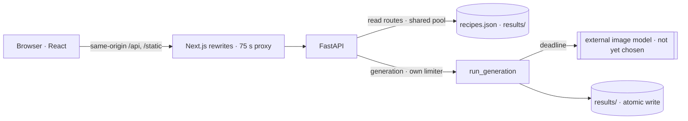
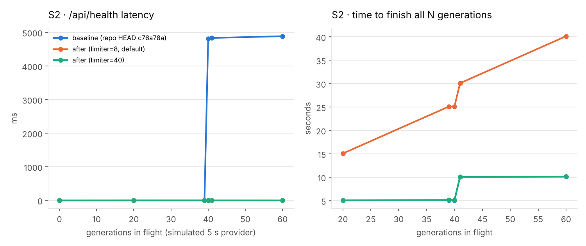
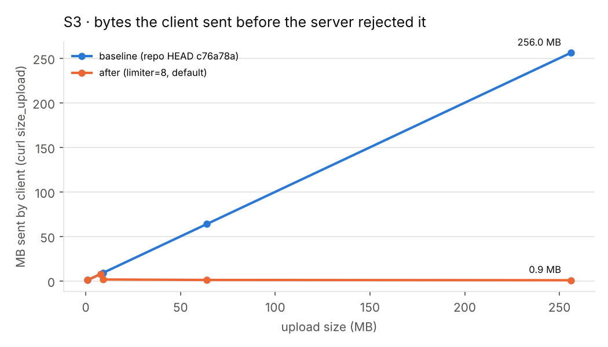

# mosAIc — Reliability Engineering for a Provenance-First AI Image Service

*Engineering case study · October 2026 · repository `joojoohappy/mosAIc`*

## 1. Executive technical summary

mosAIc lets people try image-generation prompts that creators shared publicly, while keeping the creator visible and never misrepresenting how a result was made. The system is a Next.js web client and a FastAPI backend that will call an external image model. **The model integration is not built yet**; what exists is the serving shell around it: the API contract, a three-mode result pipeline (`live` / `cached` / `mock`) with server-authored disclosure, trust boundaries, and a failure-aware client.

This study audited that shell, reproduced its 67 existing tests, and load-tested the paths that will matter once a slow, occasionally hanging, paid model is attached. Three reliability defects were found and fixed with before/after measurements:

| Property | Before | After |
|---|---|---|
| `/api/health` latency with 40–60 slow generations in flight | ~4.8 s (thread-pool starvation) | 2–11 ms |
| Caller experience when the model hangs | request open until the client gave up (20 s test cap; 75 s in production config) | labelled fallback result at the deadline (5.1 s at test setting; 60 s default) |
| Bytes the client had sent when a 256 MB upload was rejected (curl `size_upload`) | 268 MB, all parsed by the server (~0.7 s on loopback) | < 1.3 MB (~1 ms) |

All figures come from [`benchmarks/`](../../benchmarks/) and are reproducible; see [04](04-benchmark-results.md).

## 2. Engineering problem

An AI demo has three ways to fail its users quietly: show a pre-made image as if generated from their photo, leak the prompt or API key, or hang. Once a real provider is attached, a fourth appears: a few slow calls make the *whole* service look down. The engineering question was whether the existing design would hold under those conditions, and what the smallest changes are that make it hold.

## 3. Scope and ownership

| Work | Owner |
|---|---|
| Product definition, Build Day plan, API/route contract, integration of agent-written frontend | repo owner (`joojoohappy`) |
| Original FastAPI backend and its tests | teammate (Zoe Wu), co-authored with an AI assistant |
| Next.js frontend | Codex coding agent, reviewed and merged by the repo owner |
| Audit, benchmark harness, reliability fixes (ADR-7/8/9), new tests, CI workflow, these documents | this study |

## 4. System architecture

Details, file references and component status: [01-architecture-audit.md](01-architecture-audit.md).

## 5. Technology stack

Python 3 · FastAPI / Starlette / uvicorn · AnyIO · TypeScript · Next.js 16 / React 19 · pnpm workspaces (`packages/api`, `types`, `core`) · stdlib `unittest`, Node test runner · Docker (verification images). Benchmarks: Python + a zero-dependency Node load generator, curl, Playwright/Chromium for one client-behaviour probe.

## 6. AI integration and workflow design

There is no model call yet (`_call_provider` raises `NotImplementedError`). The workflow *around* it is designed and tested:

- **Input**: `recipeId` + one image. The prompt is loaded server-side; the public projection is an allowlist, so the prompt cannot reach a client.
- **Validation**: size (now enforced before parsing), magic-byte header checks (not full decoding), readiness gate (`tryReady`).
- **Execution**: provider call under a concurrency limit, with a bounded wait after which the caller gets a fallback (this study; the provider call itself is not cancelled).
- **Output validation**: provider bytes must pass the same magic-byte check as uploads; a "200 with text" is a failure.
- **Fallback**: a pre-generated `cached` result only if its provenance sidecar is complete and its image is real; otherwise `mock`.
- **Disclosure**: the server writes `sourceNote`; the client renders it verbatim and rejects payloads where `mock` carries an image.

## 7. Deployment strategy

Two processes (Next.js, FastAPI) behind one origin via Next rewrites with a 75 s proxy timeout; results on local disk. Docker images exist for local verification only. No production deployment exists; requirements for one are listed in [06](06-production-readiness.md).

## 8. Critical engineering decisions

Full records: [07-architecture-decisions.md](07-architecture-decisions.md). The three made in this study:

- **ADR-7 — Dedicated generation limiter + async health.** Starlette runs sync routes on AnyIO's 40-slot default limiter; generation shared it with every read route. A separate `CapacityLimiter` (default 8, configurable) isolates them without changing the HTTP contract. Cost: generation throughput is capped at `limit / provider latency` — intended, and tied to the provider's rate limit.
- **ADR-8 — Bounded wait in the pipeline.** Provider calls run in a bounded executor; on timeout the caller gets a fallback (the started call keeps running; it is not cancelled). Abandoning a thread is safe only because the provider function never writes — an invariant pinned by a new test.
- **ADR-9 — Upload limit at the ASGI layer.** FastAPI parses the multipart body before the route runs, so an in-route size check is too late. A ~60-line middleware rejects by `Content-Length` or by counting streamed bytes, preserving `400 {"error":"too_large"}`.

## 9. Testing and benchmark methodology

- Existing suites reproduced: 36 unit, 17 HTTP contract, 9 client, 5 real-wire — all pass. Final: 39 / 20 / 9 / 5.
- Benchmarks run against isolated temp copies of the real app; the only test double replaces the missing provider and is labelled in every table. Baseline = `git archive c76a78a`; after = final tree; same harness.
- Environment: 2 vCPU x86 sandbox, loopback, load generator co-located — so only before/after comparisons are claimed. Method: [03](03-benchmark-methodology.md).

## 10. Quantitative results

Full tables (S1 endpoint latency at concurrency 1/8/32, S2–S7): [04-benchmark-results.md](04-benchmark-results.md).

## 11. Reliability and security

Strong already: prompt confidentiality (allowlist), magic-byte header checks at two trust boundaries, path-safe ids, server-authored provenance, no automatic retry of a non-idempotent paid call, health-based failure classification in the client. Added: concurrency isolation, deadline, pre-parse size limit. Missing: rate limiting, result retention, structured logs/metrics, pinned dependencies.

## 12. Performance improvements

The improvements are reliability-under-load improvements, not speed-ups: health latency under 40–60 concurrent generations (~4.8 s → 2–11 ms), bytes a client can push before an oversized upload is rejected (268 MB → < 1.3 MB), and bounded time-to-response on a hung provider. The common-path latency (S1) was re-measured to check for regressions; see [05](05-engineering-improvements.md).

## 13. Engineering trade-offs

- Queued generations now wait inside the request; under bursts larger than `limit × 75 s / provider latency` clients will time out. Accepted for a demo; async jobs are the scale answer (ADR-3).
- Early rejection is read correctly by curl and Chromium but surfaces as a connection reset in Node's undici and Python's urllib.
- Oversized + not-ready now returns `too_large`, not `recipe_not_ready`.
- Abandoned provider calls may still complete (and bill) at the provider.

## 14. Known limitations

No model; frontend not built or tested in this study (package registry unavailable); Docker and CI not executed; FastAPI ran from source (0.160.0) because PyPI was unavailable — the authors' exact versions are unknown and unpinned; all numbers are from a 2-vCPU sandbox on loopback.

## 15. Lessons learned

- Turn design claims in comments into experiments; frameworks do work before your code runs.
- Measure with a test double only where the real component does not exist, and say so in every table.
- Good invariants (single write after the mode decision) make later reliability fixes cheap.
- Assert error codes, not just statuses — a "correct" 400 with the wrong body still breaks the UI.
- Suspect your harness first: one stalled benchmark here was the harness's own unread stdout pipe.
