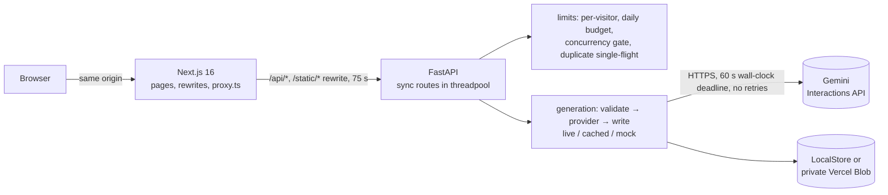

# MOSAIC: Putting a Paid Image-Generation API on the Public Web Safely

_Engineering case study · October 2026 · status: validated prototype, not yet deployed with live generation_

## 1. Executive technical summary

MOSAIC is a web gallery where visitors apply a creator's published image-generation prompt ("recipe") to their own photo. Technically it is a Next.js 16 front end and a FastAPI backend that calls an external image model (Google Gemini) synchronously, with no model hosting of its own.

The engineering problem is not inference; it is **operating a slow, paid, failure-prone external model behind an anonymous public URL**: bounding spend, refusing abuse without accounts, failing honestly, and fitting serverless limits. The v0.1 release candidate implements four layers of cost control, explicit failure semantics (`live` / `cached` / `mock` results, never a fallback presented as the user's image), spoof-resistant visitor identity across two tiers, and ~120 automated checks in CI (134 after this pass).

A measurement pass then tested those guarantees with a reproducible harness (local fake model server, k6, `/proc` sampling, git-worktree baselines). It found **four places where the code did not do what its documentation said**, fixed each with a regression test, and re-measured:

| Defect                                      | Before                                             | After                                                   |
| ------------------------------------------- | -------------------------------------------------- | ------------------------------------------------------- |
| Provider "60 s timeout" was per socket read | 2 s setting held for **12.6 s** by a slow upstream | **2.07 s**                                              |
| Overlapping duplicate requests              | **2** paid calls                                   | **1**                                                   |
| Truncated JPEGs reaching the paid model     | **6 / 6** damaged files                            | **1 / 6** (the remaining one also passes a full decode) |
| Multi-process temp-file collision           | **6** HTTP 500s in 20 trials                       | **0**                                                   |

One fix costs latency (+13.7 ms per 3 MP upload) and was kept deliberately. One known weakness, a budget counter that is approximate across processes, was measured and _not_ fixed, with the reasoning recorded.

What has **not** been verified: a single real Gemini call, a real Vercel Blob store, or a deployed environment. Those are the next steps, and nothing below should be read as production performance.

## 2. Engineering problem

- Every click costs money (~$0.036 per image at the provider's list price, per the project's estimate). The site is anonymous and public.
- The model takes seconds to a minute and can fail, refuse, stall or return non-images.
- Results must be shareable by link, but the target platform (Vercel functions) has no persistent disk and a 4.5 MB request body limit.
- The prompts belong to third-party creators: they are used only when verified (`tryReady`), and the client must never be able to submit its own prompt.

## 3. Project scope and ownership

MOSAIC is a small multi-author project. Authorship is visible in the public git history, so it is stated plainly here:

- **Product definition, specification and seed content** (recipe format, wireframes, build-day plan): the repository owner.
- **Initial backend architecture, unit tests and monorepo layout:** a collaborating engineer.
- **Web front end (first version):** generated with an AI coding agent (Codex) under the owner's direction.
- **v0.1 release candidate (Gemini integration, limits, storage, CI, E2E)** and **this measurement and hardening pass:** produced with an AI coding agent (Claude Code) under the owner's direction, reviewed and directed by the owner.

The owner's engineering role is specification, prioritisation, review and decision-making across these contributions, not hand-writing most of the code. Interview discussion should stay on decisions and evidence the owner can defend in depth (see [09](09-hiring-review.md)).

## 4. System architecture

One generation: body cap (8.5 MB, before parsing) → server-side recipe lookup by ID → `tryReady` gate → content validation (magic bytes, pixel cap, decode) → content-hash duplicate check → per-visitor limits → in-flight single-flight → concurrency gate (2) → daily budget reservation → model call → write image, then JSON → return `resultId`. Details: [01](01-architecture-audit.md).

## 5. Technology stack

| Layer                    | Choice                                                                                                                                   |
| ------------------------ | ---------------------------------------------------------------------------------------------------------------------------------------- |
| Web                      | Next.js 16.3 (App Router, webpack build), React 19.3, TypeScript, pnpm workspaces                                                        |
| Shared packages          | Typed API client with runtime response validation; shared types; upload rules; CSS tokens                                                |
| Backend                  | Python 3.12, FastAPI 0.159, uvicorn, Pillow 13, stdlib `urllib` for the model call                                                       |
| Model                    | Google Gemini image model via REST (no SDK)                                                                                              |
| Storage                  | Local disk or Vercel Blob (private), behind a two-method interface                                                                       |
| Hosting                  | Two Vercel projects (web, API); Docker + compose for local integration                                                                   |
| Quality                  | `unittest`, shell HTTP contract test, Node test runner, Playwright + axe-core, ruff, Prettier, `pip-audit`, `pnpm audit`, GitHub Actions |
| Measurement (this study) | k6 1.3, custom Python harness, fake model server, matplotlib                                                                             |

## 6. AI integration and workflow design

The AI part is deliberately thin: one request per generation (prompt text + base64 photo + aspect ratio) and one image back. The design effort is around it:

- **Server-owned prompts.** The client sends a recipe ID, never prompt text, so the API key cannot be repurposed.
- **Provider output is untrusted.** Returned bytes pass the same magic-byte check as uploads; a text-only answer (e.g. a refusal) is a failure, not a result.
- **No retries.** A retry is another paid call. Failures map to public reason codes (`provider_timeout`, `provider_no_image`, `provider_error`); details stay in server logs.
- **Honest fallbacks.** If the model fails, the result is a pre-generated example labelled with its provenance (`cached`) or a placeholder (`mock`), never shown as the user's image. The invariant that makes this safe: only one function writes results, after the mode is decided.
- **Synchronous by design.** At ≤ 2 concurrent and ≤ 50 calls/day, a queue would add more failure modes than it removes ([ADR-1](07-architecture-decisions.md)).

There is no agent loop, orchestration, retrieval, fine-tuning or local inference in this project.

## 7. Deployment strategy

Web and API are separate Vercel projects; the web tier rewrites `/api/*` to the API, so browsers see one origin and no CORS is needed. Timeouts are layered (provider 60 s < rewrite 75 s = client 75 s). Live generation switches itself off on Vercel unless shared storage is connected, so a misconfigured deploy cannot pay for results that would vanish. Rollback is Vercel Instant Rollback, or removing the API key to fall back to demo mode. A smoke-test workflow runs against each deployment (read-only unless explicitly told to make one billable call).

Status: previews build, but none has been smoke-tested (Deployment Protection), and production still serves the pre-release version.

## 8. Critical engineering decisions

Full records in [07](07-architecture-decisions.md). The ones worth discussing:

1. **Load shedding over queueing** (503 at 2 concurrent): bounds spend and memory (~30–44 MB per in-flight 7.6 MB upload); refused users learn in ~0.1 s.
2. **Visitor identity signed by the web tier**, never `X-Forwarded-For`: closes a limit bypass found in review.
3. **Refuse to spend without shared storage.**
4. **Wall-clock deadline via a worker thread** rather than adding an HTTP client dependency.
5. **Reduced-scale JPEG decode** for validation: same detection as a full decode at half the cost; the cheaper end-marker check was rejected because it breaks motion photos.
6. **Not** making the budget counter atomic across instances: the provider-side spend cap is the real guard; Redis for a ~$54/month ceiling is not justified.

## 9. Testing and benchmark methodology

- Existing suite: ruff + Prettier + `tsc`, 84 backend unit tests, 18 HTTP contract checks, 19 Node tests (client, real upload over the wire, proxy), production build, 10 Playwright journeys + 3 quality checks (axe on 12 routes × 2 widths, link check, performance budget), dependency audits.
- Benchmarks ([03](03-benchmark-methodology.md)): read latency with k6 at concurrency 1/8/32 (3 × 1,000 requests after warm-up); generate overhead by photo size; load shedding; memory; eight reliability scenarios against a fake model that can error, hang, drip, refuse or return junk; container start/restart. Baseline and after runs use the same harness on the same machine, with the baseline checked out from the release candidate commit.
- Rule applied throughout: anything involving the model is labelled **simulated**.

## 10. Quantitative results

From [04](04-benchmark-results.md) (single 4-vCPU sandbox; loopback; simulated model):

- Read endpoints, one worker: p50 0.6–1.1 ms at concurrency 1; saturation at ~850–1,100 req/s for JSON endpoints (~1 core), ~2,600 req/s for the health check.
- Generation overhead excluding the model (p50): 11 ms (0.3 MP), 39 ms (3 MP), 132 ms (12 MP), including the new decode step.
- Load shedding: bursts of 10 and 20 → exactly 2 served, 2 model calls, rejections in ≤ 111 ms.
- Failure handling: all 7 simulated provider behaviours end in the right labelled result within the 2 s test deadline (after fix).
- Abuse: 6 forged `X-Forwarded-For` values → 3 allowed, 3 × 429; budget of 5 → exactly 5 model calls.
- Container: healthy ~1.0 s after `docker run`, ~1.3 s after restart; results survive SIGKILL.

## 11. Reliability and security

Reliability rests on: deadline-bounded model calls, no retries, labelled fallbacks, image-then-JSON write ordering, atomic local writes, load shedding, and refusing to spend without shared storage. Security rests on: server-side prompts, allowlisted public fields, content-checked uploads with a pixel cap, an 8.5 MB body cap enforced before parsing (including chunked bodies), strict ID validation before any storage access, spoof-resistant visitor identity, no CORS, API docs disabled, pinned and audited dependencies.

Known gaps: static shared secret between tiers; no security-header review; image-embedded prompt injection not assessed against a real model; privacy/terms pages not legally reviewed.

## 12. Performance improvements

The measurable changes in this pass were reliability changes, not speed-ups (table in §1). The only performance movement was a deliberate **regression**: validation now costs 1–50 ms depending on photo size, in exchange for never paying for a truncated upload. Read-path optimisations (recipe caching, response encoding) were measured as not worth doing at this traffic.

## 13. Engineering trade-offs

| Chose                     | Over                   | Because                                   | Cost                                   |
| ------------------------- | ---------------------- | ----------------------------------------- | -------------------------------------- |
| Synchronous requests      | queue + polling        | no extra infrastructure at ≤ 2 concurrent | requests held for the model's duration |
| 503 shedding              | queueing               | bounded spend and memory                  | users retry manually                   |
| No retries                | backoff                | each retry is paid                        | transient failures lose a result       |
| stdlib `urllib`           | SDK or `httpx`         | minimal dependencies                      | had to build the deadline by hand      |
| Approximate global budget | atomic counter service | provider spend cap already required       | small overshoot across instances       |
| Decode-based validation   | header check           | stops paying for broken uploads           | +13.7 ms per typical upload            |

## 14. Known limitations

- **Never run against the real model.** Request/response format is from documentation; latency, cost and quality are unmeasured.
- Vercel Blob storage and the deployed configuration are unverified; no recipe is open for generation yet (creator rights pending).
- Per-visitor limits, duplicate suppression and the concurrency gate are per instance.
- Observability is plain log lines: no request IDs, metrics or alerts.
- Expired results are hidden, not deleted.
- Mid-file JPEG corruption is not detected (nor by a full decode).
- All benchmark numbers come from one shared sandbox with the load generator on the same host.

## 15. Lessons learned

1. **Documentation describes intent; measurements describe behaviour.** Four guarantees in docstrings and release reports were not true under the right input. Each was found by constructing the input, not by reading the code.
2. **Test the boundary that matters, not the easy one.** The truncation test cut a file to 40 bytes (header failure); the refresh test waited for the first request to finish. Both passed while the real defect remained.
3. **Benchmark the client first.** A Python async load client reported ~106 ms p50 for a health check that k6 measured at ~12 ms on the same server, while the server sat at 15 % CPU; the first tool was measuring itself.
4. **Library timeouts rarely mean "total time".** Read the semantics; then test with a slow-drip server.
5. **"Not fixing it" is a result too,** when the measurement, the deployment shape and the cost of the fix are written down.
