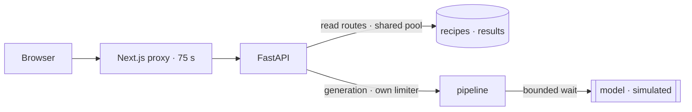

# mosAIc — Reliability hardening of an AI image service, before the model is attached

**One-page summary.** Details: [methodology](03-benchmark-methodology.md) · [results](04-benchmark-results.md) · [raw data](../../benchmarks/results/) · [all documents](README.md)

| | |
|---|---|
| Baseline | `c76a78a` (main) |
| After | branch `case-study/engineering-audit` |
| Pull request / CI | see the PR for this branch on GitHub |
| Status | Validated prototype. **No AI model is integrated yet** (`_call_provider` raises `NotImplementedError`). |

## Context

mosAIc lets people try image-generation prompts that creators shared publicly, and labels every result as `live` (from your photo), `cached` (a pre-generated sample) or `mock`. The FastAPI backend already had a careful contract (prompts never leave the server, server-written provenance notes, no automatic retry of the paid call) and 67 passing tests. The question for this study: **will the service stay healthy once a slow, sometimes-hanging model is plugged in?**

**Ownership.** The original backend was written by a teammate (with an AI assistant) and the Next.js frontend by a coding agent; I owned the product and API contract. This study — the audit, benchmark harness, fixes and tests below — was carried out with an AI coding assistant under my direction; every change is in one reviewable commit range.

## Method

The real FastAPI app ran from isolated copies of the baseline and the patched tree, using the same harness for both. The missing model was replaced by a **simulated provider** (`sleep`). Every number below comes from that set-up on a 2-vCPU sandbox over loopback, so only before/after comparisons are claimed.

## Findings and fixes

| Problem found | Fix | Before → After |
|---|---|---|
| Generation shared Starlette's 40-thread pool with every read route; once 40 slow calls were in flight, `/api/health` queued, so the client would report "backend down" | Dedicated AnyIO capacity limiter for generation (configurable); health served on the event loop | Health with 40 in flight (simulated 5 s calls): **4,818.9 ms → 2.0 ms** |
| No time limit on the model call; against a provider that never returns, the request stayed open until the client gave up | Provider call runs in a bounded executor; at the deadline the caller gets a labelled fallback (the started call is **not** cancelled) | No response within 20 s → **fallback at 5.06–5.08 s** (5 s test setting; 60 s default) |
| Upload size was checked only after Starlette had parsed the whole multipart body | Pure-ASGI guard rejects by `Content-Length`, or once a chunked body crosses the limit; same `too_large` error | 256 MB upload: client sent **268 MB → < 1.3 MB** before rejection (curl `size_upload`) |

**Trade-offs, measured:** with the default limit of 8, sixty 5 s generations take 40 s instead of 10 s (the limit should match the provider's rate limit). `POST /generate` (mock path) is 1.0 ms slower at concurrency 1. Oversized uploads to an unready recipe now return `too_large` instead of `recipe_not_ready`. Node's undici and Python's urllib see a connection reset instead of the early 400; curl and Chromium read it. Tests went from 36 unit + 17 HTTP checks to 39 + 20.

## What this does not show

- No model latency, cost or output quality: there is no model yet.
- The frontend build and Docker images were not re-verified (the package registry was unreachable from the study environment).
- Magic-byte checks confirm a file's header, not that it decodes; provenance sidecars are checked for consistency, which does not prove where an image came from.

**Next:** integrate a real image provider and measure p50/p95/p99 latency, timeout rate, failure rate and cost per successful generation; add structured logs and rate limiting.
