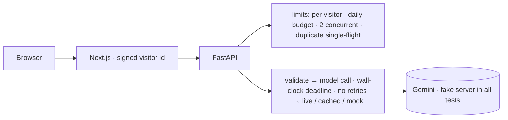

# MOSAIC: putting a paid image-generation API on the public web safely

**One-page summary.** Full write-up: [08](08-portfolio-case-study.md) · numbers: [04](04-benchmark-results.md) · method: [03](03-benchmark-methodology.md) · raw data: [`benchmarks/results/`](../../benchmarks/results/) · all documents: [README](README.md)

|          |                                                                                                                                                                                 |
| -------- | ------------------------------------------------------------------------------------------------------------------------------------------------------------------------------- |
| Baseline | PR #2 (v0.1 release candidate), `fbbc625`                                                                                                                                       |
| After    | this branch (PR #3)                                                                                                                                                             |
| Status   | Validated prototype. Gemini integration is written but **has never made a real call**: every generation number below comes from a local fake model server. Nothing is deployed. |

## Problem

Visitors apply a creator's published image prompt to their own photo. Each generation is a paid call to Google Gemini that takes seconds to a minute and can stall, refuse or return a non-image. The site is anonymous, so the engineering work is about **bounding spend, refusing abuse without accounts, and failing honestly**. Model inference itself is not part of it.

## What the measurement pass found

A reproducible harness (fake model server, k6, baselines checked out with git worktree) tested the release candidate's documented guarantees. It found four places where the code did not do what its documentation said, plus one wrong error code (carried over from an earlier review). Each was fixed and pinned by a regression test that fails on the old code:

| Defect on PR #2                                                                                            | Before                                   | After                                          |
| ---------------------------------------------------------------------------------------------------------- | ---------------------------------------- | ---------------------------------------------- |
| The "60 s timeout" only limited each socket read; a slow-drip upstream with a 2 s setting held the request | 12.6 s, stored as `live`                 | 2.07 s, `provider_timeout`                     |
| A refresh or second click during the model call paid twice                                                 | 2 provider calls                         | 1                                              |
| Damaged JPEGs passed header-only validation and reached the paid call                                      | 6 / 6                                    | 1 / 6 (the last one also passes a full decode) |
| Two worker processes collided on a fixed temp-file name                                                    | 6 HTTP 500s in 5 trials (4 workers each) | 0                                              |
| A chunked upload over the size cap got FastAPI's generic 400 instead of the contract's `413 too_large`     | wrong error code                         | `413 too_large`                                |

## Trade-offs kept on purpose

- Decoding JPEGs adds **+13.7 ms** p50 per 3 MP upload. That is under 1 % of a model call, and it stops the site paying for broken uploads.
- The daily budget is exact in one process but **overshoots across processes** (51–53 calls against a limit of 50 with 4 workers; one baseline trial reached 73). A cross-instance counter would mean new infrastructure for a ~$54/month ceiling, so the provider-side spend cap remains the real guard.
- Calls stay synchronous: with at most 2 concurrent and 50 per day, a queue would add more failure modes than it removes.

## Ownership

Product definition, specification and review: the repository owner. Initial backend: a collaborating engineer. Front end, the v0.1 release candidate and this measurement pass: AI coding agents (Codex, Claude Code) working under the owner's direction. Every change sits in reviewable PRs (#2, #3).

## Not shown yet

There is no real Gemini latency, cost or output-quality data, no real Vercel Blob store, and no deployed environment. **Next:** make one live call with a spend cap set, then measure p50/p95/p99 latency, timeout rate and cost per successful image on a protected preview deployment.
